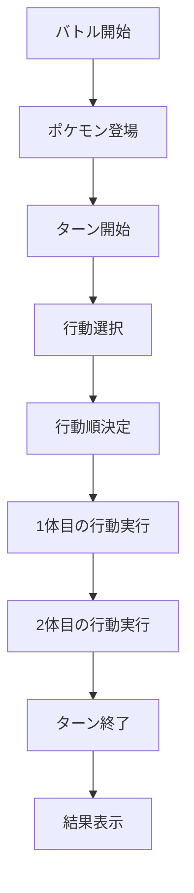
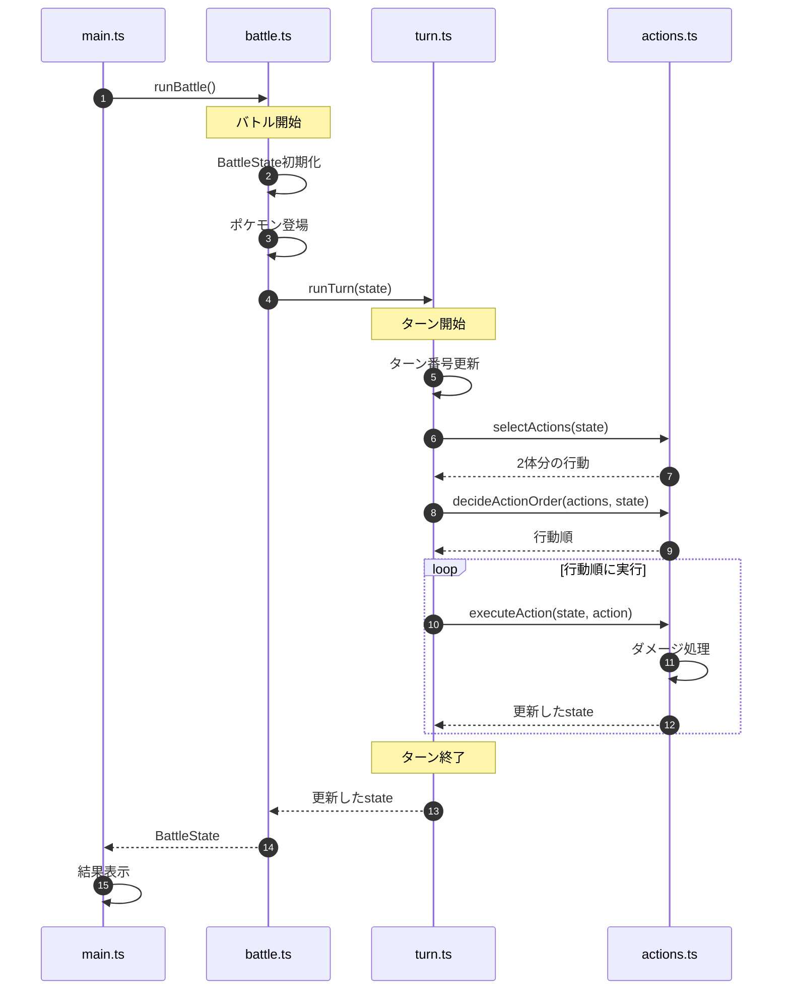

# Step 1：バトル開始からターン終了まで

## 1. 目的

ポケモンバトルの全体的な処理の流れを理解するため、バトル開始から1ターン終了までをTypeScriptで実装する。

最初は複雑な仕様を省き、基本的な処理の実行順序と状態管理に集中する。

この段階では、Section・Event・EventHandlerは導入しない。

Step 2以降で、公開講演を参考にしたイベント駆動設計を学ぶための土台を作る。

### 学習目標

- バトル全体の処理の流れを理解する
- 各処理の責務を整理する
- BattleStateによる状態管理を理解する
- 関数間の呼び出し関係を理解する
- 実行ログから処理の流れを追跡できるようにする

## 2. 実装するバトル

### バトル条件

| 項目 | 設定 |
| --- | --- |
| バトル形式 | 1対1 |
| ターン数 | 1ターン |
| ポケモン① | ガブリアス |
| ポケモン② | カバルドン |
| 初期HP | 両方100 |
| 素早さ | ガブリアス120、カバルドン60 |
| 使用技 | 両方じしん |
| ダメージ | 固定20 |
| 行動順 | 素早さが高い順 |
| 特性・持ち物 | なし |

※HP、素早さ、ダメージは学習用の仮値とする。

本Stepはこの固定シナリオのみを対象とする。同速、HPが20以下などの任意入力への対応は完了条件に含めない。汎用的な入力を受け付ける段階で、ひんしや同速の仕様とテストを追加する。

### 実装しないこと

- 実際のダメージ計算式
- 命中・回避・急所判定
- 特性・持ち物
- 状態異常
- 天候・フィールド
- ポケモン交代
- ひんし判定
- バトル勝敗判定
- 同速時の行動順抽選
- 複数ターン
- Section・Event・EventHandler

## 3. バトル全体のフローチャート



### 各処理の役割

| 処理 | 内容 |
| --- | --- |
| バトル開始 | BattleStateを初期化する |
| ポケモン登場 | 2体のポケモンを登場させる |
| ターン開始 | ターン番号を更新する |
| 行動選択 | 各ポケモンの行動を決定する |
| 行動順決定 | 素早さに基づいて実行順序を決める |
| 行動実行 | 相手に固定20ダメージを与える |
| ターン終了 | ターンの終了を記録する |
| 結果表示 | 最終HPと実行ログを表示する |

## 4. シーケンス図

各ファイル間の呼び出し関係を整理する。



### 設計方針

- `main.ts` はプログラムの起動と結果表示を担当する
- `battle.ts` はバトル開始とターン実行の呼び出しを担当する
- `turn.ts` はターン内の処理順序を管理する
- `actions.ts` は行動選択・行動順決定・行動実行を担当する
- バトル状態は `BattleState` で一元管理する

Step 1では通常の関数呼び出しを使用する。

## 5. 実装時のディレクトリ構成（予定）

現在存在するのは `README.md` とルート直下の `step1.md` のみ。以下のコード・設定・テストは今後作成する。

```text
pokemon-battle-event-driven-design/
├── README.md
├── step1.md
├── src/
│   ├── main.ts
│   └── battle/
│       ├── types.ts
│       ├── battle.ts
│       ├── turn.ts
│       └── actions.ts
├── tests/
│   └── step1.test.ts
├── package.json
└── tsconfig.json
```

### ファイルの責務

| ファイル | 責務 |
| --- | --- |
| main.ts | プログラム起動・結果表示 |
| types.ts | Pokemon・Action・BattleStateの型定義 |
| battle.ts | バトル開始・ポケモン登場 |
| turn.ts | ターン開始から終了までの進行 |
| actions.ts | 行動選択・行動順決定・攻撃実行 |
| step1.test.ts | Step 1の動作検証 |

## 6. 状態管理

バトル中の情報は `BattleState` で管理する。

### Pokemon

ポケモンの状態を表す。

- ID
- 名前
- 現在HP
- 最大HP
- 素早さ

### Action

1回の行動を表す。

- 行動するポケモンのID
- 対象ポケモンのID
- 使用技

### BattleState

バトル全体の状態を表す。

- ターン番号
- 参加しているポケモン
- 実行ログ

Step 1では同じ `BattleState` を関数間で受け渡し、直接更新する。`executeAction`・`runTurn` は更新した同じ参照を返す。`runBattle()` の呼び出しごとに新しい状態とログ配列を作り、前回の実行と共有しない。

初期ターン番号は0、`runTurn` の開始時に1加算する。行動選択と行動順決定ではHPを変更しない。ログは状態内の配列に追記し、コンソールへの表示は `main.ts` でまとめて行う。以降の「ログを出力する」は、この配列への追記を意味する。

## 7. 実装順序

### 7.1 バトル開始

- BattleStateを初期化する
- ガブリアスを登場させる
- カバルドンを登場させる

### 7.2 ターン開始

- ターン番号を0から1に更新する
- ターン開始ログを出力する

### 7.3 行動選択

- ガブリアスは「じしん」を選択する
- カバルドンは「じしん」を選択する
- 2体分のActionを生成する

### 7.4 行動順決定

- 2体の素早さを比較する
- 素早さが高い順にActionを並べる
- ガブリアスが先に行動する

### 7.5 行動実行

- 使用技をログに出力する
- 対象ポケモンに20ダメージを与える
- 対象のHPを更新する
- 次のポケモンの行動を実行する

### 7.6 ターン終了

- ターン終了ログを出力する
- 更新後のBattleStateを返す

## 8. 期待する実行結果

```text
=== バトル開始 ===

ガブリアスが登場
カバルドンが登場

=== ターン1 開始 ===

ガブリアス：じしん
カバルドン：じしん

行動順：
1. ガブリアス
2. カバルドン

ガブリアスのじしん！
カバルドンに20ダメージ！

カバルドンのじしん！
ガブリアスに20ダメージ！

=== ターン1 終了 ===

ガブリアス HP：80 / 100
カバルドン HP：80 / 100
```

## 9. テストケース

| ID | テスト内容 | 期待結果 |
| --- | --- | --- |
| TC-01 | バトル開始 | 2体が登場する |
| TC-02 | ターン開始 | ターン番号が1になる |
| TC-03 | 行動選択 | 両方がじしんを選択する |
| TC-04 | 行動順決定 | ガブリアスが先になる |
| TC-05 | ガブリアスの攻撃 | カバルドンのHPが80になる |
| TC-06 | カバルドンの攻撃 | ガブリアスのHPが80になる |
| TC-07 | ターン終了 | 両方のHPが80になる |
| TC-08 | 実行ログ | 開始 → 登場 → ターン開始 → 選択 → 順序決定 → 各攻撃 → ターン終了の順で、各処理が重複せず記録される（表示用の空行は検証対象外） |
| TC-09 | 同じバトルを2回実行 | 各回がターン1・両者HP80になり、状態とログ配列を共有しない |

## 10. 完了条件

- [ ] TypeScriptでバトル開始から1ターン終了まで実行できる
- [ ] BattleStateでバトル状態を管理できる
- [ ] 行動選択と行動順決定ができる
- [ ] 2体が順番に攻撃できる
- [ ] HPが正しく更新される
- [ ] 処理順序をログで確認できる
- [ ] シーケンス図と実装が対応している
- [ ] すべてのテストケースがPASSする

## 11. Step 2への引き継ぎ

Step 2では、今回実装したバトル処理をSectionとして構造化する。

### 検討すること

1. どの処理をSectionとして定義するか
2. Sectionの入力・出力をどう設計するか
3. Sectionを階層的に組み合わせる方法
4. Sectionの実行順序を管理する方法
5. Eventを発火させる場所をどこに設けるか

### Step 2の目標

Step 1で動いていたバトルの実行結果を変更せず、内部構造だけを改善する。

**まずは動くものを作り、その後で構造化する。**
