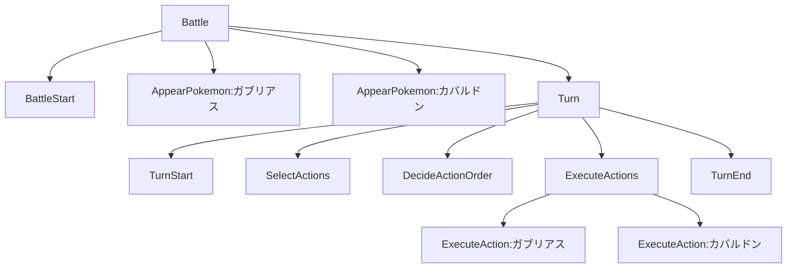
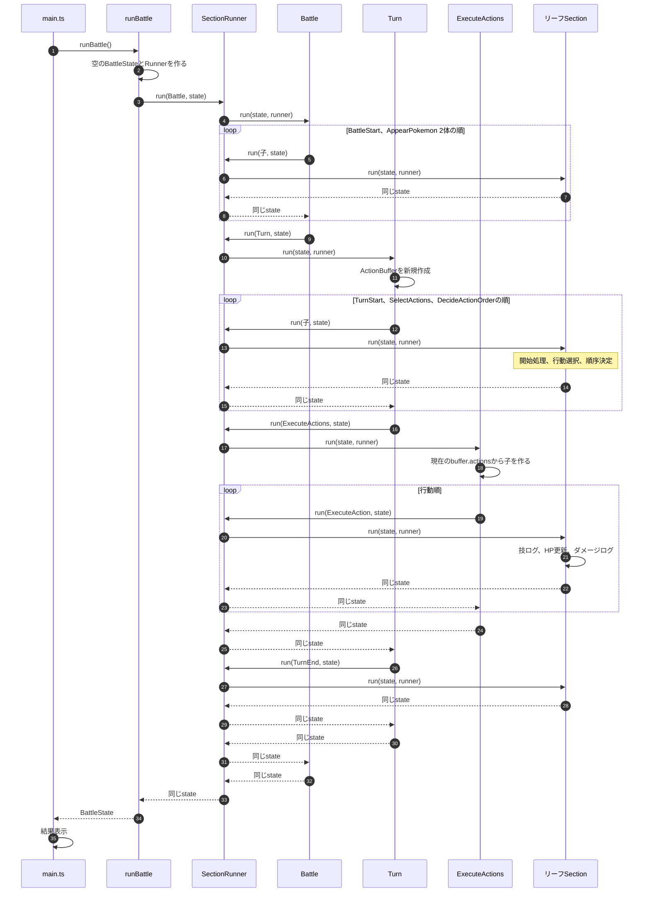

# Step 2：Sectionによる構造化

> この設計書のファイル配置は当時の構成です。現在の配置と読み進め方は[バトル実装の読み方](src/battle/README.md)を参照してください。

## 1. 目的

Step 1で動いている1ターンのバトルを、Sectionの階層として組み立て直す。

READMEの学習方針に沿って、小さな処理をSectionとして組み合わせる。以下のAPIと実行規則は、この学習用実装で定めるものとする。EventとEventHandlerはまだ導入しない。

本書の構造とテストは実装済みである。

最終HP、ターン番号、実行ログはStep 1と一致させる。変わるのは内部の呼び出し構造である。

### 学習目標

- どの処理をSectionにするかを決める
- 親Sectionが子Sectionを順に実行する形を理解する
- バトルの状態と、ターン中だけの行動リストを分けて持つ
- 実行結果を変えずに構造だけを変えられることをテストで確認する
- 次のStepでEventを発火する位置を決めておく

## 2. 対象にするバトル

Step 1と同じ固定シナリオだけを対象にする。

| 項目 | 設定 |
| --- | --- |
| バトル形式 | 1対1 |
| ターン数 | 1ターン |
| ポケモン① | ガブリアス |
| ポケモン② | カバルドン |
| 初期HP | 両方100 |
| 素早さ | ガブリアス120、カバルドン60 |
| 使用技 | 両方じしん |
| ダメージ | 固定20 |
| 行動順 | 素早さが高い順 |
| 特性・持ち物 | なし |

数値は学習用の仮値のままとする。同速、ひんし、複数ターンは扱わない。

### 実装しないこと

- Eventの発火、EventHandlerの登録と実行
- 実際のダメージ計算式
- 命中・回避・急所判定
- 特性・持ち物
- 状態異常
- 天候・フィールド
- ポケモン交代
- ひんし判定
- バトル勝敗判定
- 同速時の行動順抽選
- 複数ターン
- Section名の実行ログへの追加

Sectionを実行した記録は、バトルの実行ログとは別のトレースでテストする。`BattleState.logs` の文言と順番は変えない。

## 3. Sectionの階層

Step 1の関数を、次の木に対応させる。



### 各Sectionの責務

| Section | 親 | 処理 |
| --- | --- | --- |
| Battle | なし | 子を上から順に実行する |
| BattleStart | Battle | `=== バトル開始 ===` をログへ追加する |
| AppearPokemon | Battle | 1体を参加リストへ追加し、登場ログを追加する |
| Turn | Battle | ターン中の子を順に実行する |
| TurnStart | Turn | ターン番号を1加算し、ターン開始ログを追加する |
| SelectActions | Turn | 両者の「じしん」を選び、選択ログを追加する。HPは変えない |
| DecideActionOrder | Turn | 素早さが高い順に並べ、行動順ログを追加する。HPは変えない |
| ExecuteActions | Turn | 行動順に `ExecuteAction` を実行する |
| ExecuteAction | ExecuteActions | 既存の `executeAction` を1回呼び、技ログ → 対象HPを20減算 → ダメージログの順に処理する |
| TurnEnd | Turn | ターン終了ログを追加する |

登場と攻撃は、ポケモンごとに1つのSectionにする。選択と行動順決定は、2体分をまとめた1つのSectionのままにする。Step 1の処理の切れ目を、そのままSectionの境界にする。

`ExecuteActions` 配下の `ExecuteAction` の順番は、`DecideActionOrder` の結果で決まる。このシナリオではガブリアスが先、カバルドンが後になる。

## 4. 呼び出し

`runBattle()` は空の `BattleState` を作り、`Battle` Sectionを実行して、その状態を返す。結果表示はこれまでどおり `main.ts` が行う。



親は、子の `run` が返ってから次の子を実行する。並列実行や優先度の並べ替えは行わない。

## 5. ディレクトリ構成

Step 1のファイル構成を維持し、既存の進行処理をSection経由に変更する。`section.ts` と `step2.test.ts` を追加する。

```text
src/
├── main.ts
└── battle/
    ├── types.ts
    ├── section.ts
    ├── battle.ts
    ├── turn.ts
    └── actions.ts
tests/
├── step1.test.ts
└── step2.test.ts
```

| ファイル | 責務 |
| --- | --- |
| `main.ts` | 起動と結果表示。表示文は変えない |
| `types.ts` | `Pokemon`、`Action`、`BattleState`。形はStep 1のまま |
| `section.ts` | `Section`、`SectionRunner`、`ActionBuffer` |
| `battle.ts` | `runBattle` と `Battle` 配下のSection |
| `turn.ts` | `Turn` と、ターン中に子を並べる処理 |
| `actions.ts` | 選択、行動順、攻撃の具体的な処理 |
| `step1.test.ts` | Step 1の期待値をそのまま検証する |
| `step2.test.ts` | Sectionの実行順と、状態の参照が保たれることを検証する |

`selectActions`、`decideActionOrder`、`executeAction` の処理内容は `actions.ts` に残す。Sectionはそれらの呼び出し順を表す層にする。

既存テストがimportしている `runBattle()`、`runTurn(state)`、3つの行動関数のシグネチャとexportを維持する。`runTurn(state)` は新しいRunnerで `Turn` Sectionを実行する互換用の入口とする。`Battle` 配下では同じRunnerで `Turn` Sectionを直接実行し、途中で別のRunnerを作らない。

現在の `package.json` の `test` は `tests/step1.test.ts` だけを指定している。Step 2の実装時に `node --test tests/step1.test.ts tests/step2.test.ts` へ更新し、`npm test` で両方を実行する。

## 6. 状態と入出力

### BattleState

Step 1の形を維持する。

- ターン番号
- 参加しているポケモン
- 実行ログ

行動の配列は `BattleState` に入れない。選択結果はターンが終われば不要なため、バトル全体の状態と分けて持つ。

### ActionBuffer

`Turn` の `run` が実行のたびに作る、ターンの中だけで使う入れ物とする。

```typescript
export type ActionBuffer = {
  actions: Action[];
};
```

- `SelectActions` が `actions` を2件入れる
- `DecideActionOrder` がそれを素早さ順の新しい配列に置き換える
- `ExecuteActions` がその配列から `ExecuteAction` を作る
- `runBattle()` の戻り値には含めない

初期値は `{ actions: [] }` とする。選択・順序決定・一括実行の各Sectionは、同じbufferオブジェクトをクロージャで共有する。`actions` 配列そのものを生成時に取り出して保持しない。`ExecuteActions` は自身の `run` の中で、順序決定後の `buffer.actions` を読み、子を作って実行する。これにより空の配列や並べ替え前の配列を実行することを防ぐ。

`Battle`・`Turn` Sectionを再利用しても実行間で可変状態を共有しない。登場するPokemonも `AppearPokemon` の実行時に毎回新しく作る。

### Section

```typescript
export type Section = {
  name: string;
  run: (state: BattleState, runner: SectionRunner) => BattleState;
};

export type SectionRunner = {
  run: (section: Section, state: BattleState) => BattleState;
  runAll: (sections: readonly Section[], state: BattleState) => BattleState;
};
```

`run` と `runAll` は、受け取った `BattleState` と同じ参照を返す。

- `runner.run` は名前をトレースへ追記してから `section.run(state, runner)` を1回呼び、戻り値が入力と同じ参照か検査する。異なる場合はSection名を含むエラーを投げる。
- `runner.runAll` は配列順に必ず `runner.run` を経由する。空配列なら何もせず同じstateを返す。
- 親Sectionも、すべての子を渡されたRunner経由で実行する。子の `run` を直接呼ばない。
- 子が例外を投げた場合はその例外を伝播し、以降の兄弟を実行しない。状態のロールバックは行わず、その実行は失敗として扱う。トレースには失敗したSectionの開始まで残る。

`section.ts` は `createSectionRunner(trace?: string[]): SectionRunner` をexportする。指定された配列には実行開始時のSection名を追記し、既存内容を消さない。記録した名前は `BattleState.logs` へは追加しない。

`battle.ts` は `createBattleSection(): Section`、`turn.ts` は `createTurnSection(): Section` をexportする。`runBattle()` は `{ turn: 0, pokemon: [], logs: [] }` とトレースなしのRunnerを新しく作り、`createBattleSection()` の結果を実行する。構造のテストも同じファクトリを使用し、新しい空状態とトレース付きRunnerで実行する。テスト専用の別のSection階層は組み立てない。

Section名は次で固定する。

| name | 意味 |
| --- | --- |
| `Battle` | バトル全体 |
| `BattleStart` | 開始ログ |
| `AppearPokemon:ガブリアス` | ガブリアスの登場 |
| `AppearPokemon:カバルドン` | カバルドンの登場 |
| `Turn` | 1ターン |
| `TurnStart` | ターン開始 |
| `SelectActions` | 行動選択 |
| `DecideActionOrder` | 行動順決定 |
| `ExecuteActions` | 行動の一括実行 |
| `ExecuteAction:ガブリアス` | ガブリアスの攻撃 |
| `ExecuteAction:カバルドン` | カバルドンの攻撃 |
| `TurnEnd` | ターン終了 |

このシナリオで `SectionRunner` が記録する順番は、次のとおりとする。

```text
Battle
BattleStart
AppearPokemon:ガブリアス
AppearPokemon:カバルドン
Turn
TurnStart
SelectActions
DecideActionOrder
ExecuteActions
ExecuteAction:ガブリアス
ExecuteAction:カバルドン
TurnEnd
```

親の名前は、その子より前に記録する。子がすべて終わったあとで、次の兄弟を記録する。

## 7. 実装順序

### 7.1 Sectionの実行役

- `Section` と `SectionRunner` を追加する
- 子を配列の前から同期実行する
- 同じ `BattleState` が返ることを確認する

### 7.2 リーフSection

- 開始ログ、登場、ターン開始、選択、行動順、攻撃、ターン終了をSectionから既存処理へつなぐ
- 攻撃Sectionは `executeAction` に委譲し、HP更新と2行のログを重複実行しない

### 7.3 階層の組み立て

- `Turn` が `ActionBuffer` を作り、ターン開始、選択、順序決定、攻撃、終了の順で子を実行する
- `ExecuteActions` が行動順に `ExecuteAction` を作る
- `Battle` が開始、2体の登場、`Turn` の順で子を実行する
- `runBattle()` は空の状態を作って `Battle` を実行する

### 7.4 回帰確認

- `npm start` の表示がStep 1と一致する
- `tests/step1.test.ts` の期待値を変えずにPASSする
- `npm test` がStep 1とStep 2の両方を実行することを確認する
- Sectionの実行順を `tests/step2.test.ts` で確認する
- `npm run typecheck` がPASSする

## 8. 期待する実行結果

Step 1と同じ表示になる。

```text
=== バトル開始 ===

ガブリアスが登場
カバルドンが登場

=== ターン1 開始 ===

ガブリアス：じしん
カバルドン：じしん

行動順：
1. ガブリアス
2. カバルドン

ガブリアスのじしん！
カバルドンに20ダメージ！

カバルドンのじしん！
ガブリアスに20ダメージ！

=== ターン1 終了 ===

ガブリアス HP：80 / 100
カバルドン HP：80 / 100
```

`BattleState.logs` もStep 1と同じ配列のままとする。表示用の空行は、これまでどおり `main.ts` が結果表示のときだけ挿入する。

## 9. Eventを置く位置

今回は発火しない。Sectionの境界ができたので、Step 3で手を入れる位置だけを決める。

| 位置 | Step 3以降で置く通知 | 今回 |
| --- | --- | --- |
| `ExecuteAction` 内で最終ダメージを決定する前 | 将来のダメージ補正用の通知候補 | 処理を追加しない |
| `ExecuteAction` でHPを減らした直後 | 接触した防御側の反応 | 処理を追加しない |

状態異常の付与後に持ち物が反応する位置は、付与するSectionがまだないため今回は作らない。Step 4で状態異常を扱うときに追加する。

空のフック関数も、今回は置かない。通知候補はSection全体の前後ではなく、委譲先の `executeAction` 内部にある。Step 3で内部を分割し、補正結果をダメージへ反映する契約を定義する。HP更新直後の通知だけでは接触を判定できないため、接触情報と適用条件はStep 4の別シナリオで定義する。

## 10. テストケース

`tests/step1.test.ts` は維持する。加えて、構造を次のケースで検証する。

| ID | テスト内容 | 期待結果 |
| --- | --- | --- |
| TC-01 | Step 1の回帰 | ログ、ターン番号1、両者HP80、2回実行時の独立性と表示結果がStep 1と一致する |
| TC-02 | Sectionの実行順 | 6章の名前が、その順番で1回ずつ記録される |
| TC-03 | 同じ状態参照 | 各Sectionの `run` が受け取った `BattleState` と同じ参照を返す |
| TC-04 | 行動選択と行動順 | 両者のHPが100のまま、`ActionBuffer` はガブリアス、カバルドンの順になる |
| TC-05 | 攻撃Section | 先にガブリアスのSectionが実行され、カバルドンのHPだけが80になる。続くカバルドンのSectionでガブリアスのHPが80になる |
| TC-06 | ログの分離 | トレースあり・なしで状態とバトルログの値が一致し、Section名が混入しない |
| TC-07 | 参照契約への違反 | 別のstateを返す子でエラーになり、後続の子は実行されない |
| TC-08 | 子の例外 | 子の例外が呼び出し元まで伝播し、後続の子は実行されない。トレースは失敗した子まで |
| TC-09 | 空の子配列 | `runAll([], state)` は同じstateを返し、状態もトレースも変えない |
| TC-10 | Sectionの再利用 | 同じBattle Sectionを異なる空状態で2回実行しても、各回がターン1・HP80となり、Pokemonとログを共有しない |
| TC-11 | 順序決定の入力が逆順 | 同じ2体・同じ素早さで選択済みAction配列だけを逆順にし、順序決定後は新しい配列が素早さ順になる。元配列は逆順のまま |
| TC-12 | 行動配列の遅延参照 | 空bufferを参照するExecuteActionsを作った後、buffer.actionsを2件の配列へ置換して実行すると、現在の配列順に各1回攻撃する |

TC-11・12は内部部品のテストであり、バトルの入力仕様を拡張するものではない。対象のSectionファクトリを `actions.ts` からexportし、実際のTurnでも同じファクトリを使う。

TC-01は既存のStep 1テストを実行して確認する。同じ期待値をStep 2のテストへ重複して書かなくてよい。

## 11. 完了条件

- [x] Step 1の処理がSectionの階層で実行される
- [x] 親Sectionが子Sectionを前から順に実行する
- [x] `BattleState` の形と実行ログがStep 1と一致する
- [x] 行動リストは `ActionBuffer` にあり、`BattleState` には入らない
- [x] 各Sectionが同じ `BattleState` を返す
- [x] Sectionの実行順をトレースで確認できる
- [x] Eventは発火しない
- [x] `npm test` でStep 1のテストとStep 2のテストが両方実行され、PASSする
- [x] `npm run typecheck` がPASSする

## 12. Step 3への引き継ぎ

Step 3では、Sectionの処理中にEventを発火させ、個別仕様をEventHandlerで扱う。

### 引き継ぐ構造

- Sectionの木と、親が子を同期実行する順序
- `ExecuteAction` 内部のダメージ決定前とHP更新後という、通知候補の2か所
- ハンドラが1つもないときは、Step 2の最終状態とログを維持すること

### Step 3で決めること

1. Eventに持たせる情報
2. ハンドラの登録先と、登録順に同期実行するルール
3. 全ハンドラの完了後、発火したSectionの続きへ戻る方法
4. ハンドラがない場合の回帰テスト
