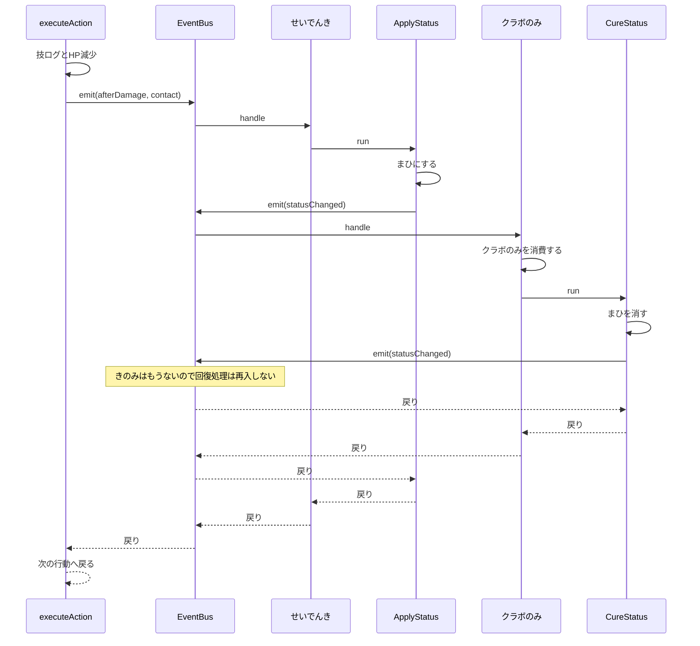

# Step 4：割り込みと連鎖

## 1. 目的

EventHandler から別の Section を呼び、割り込みが終わってから元の処理へ戻る流れを実装する。

題材は、接触攻撃を受けた防御側の特性「せいでんき」と、攻撃側の道具「クラボのみ」である。せいでんきが攻撃側をまひにし、その状態変化をきっかけにクラボのみがまひを治す。

Step 1 から Step 3 のガブリアス対カバルドンは、ハンドラなしの固定シナリオのままにする。今回の連鎖は別の学習用シナリオで検証する。

### 学習目標

- EventHandler が Section を同期的に呼べることを理解する
- 割り込み先が完了してから、呼び出し元の次の処理へ戻ることを理解する
- 状態が変わったときだけ通知する
- きのみを、回復の通知より前に消費する
- 循環したときに上限で停止する

## 2. 対象にするバトル

### 標準シナリオは変えない

`runBattle()` はこれまでどおりガブリアスとカバルドンが「じしん」を使う。ハンドラは登録しない。ログ、ターン番号、両者 HP 80 は Step 3 と同じである。

「じしん」は接触技にしない。`afterDamage` の `contact` は `false` にする。

### 連鎖シナリオ

1対1、1ターン。数値と発動の成否は学習用の指定値で、実際の発動確率や耐性は扱わない。

| 項目 | リザードン | ピカチュウ |
| --- | --- | --- |
| ID | `charizard` | `pikachu` |
| 初期HP | 100 | 100 |
| 素早さ | 100 | 90 |
| 特性 | なし | せいでんき |
| 持ち物 | クラボのみ | なし |
| 状態異常 | なし | なし |
| 技 | ほのおのパンチ | でんきショック |
| 接触 | する | しない |
| ダメージ | 固定20 | 固定20 |

まひが有効なのは、攻撃側の状態異常が空のときだけとする。タイプ相性、既存の状態異常の上書き、まひによる行動不能と素早さ低下は扱わない。

せいでんきの成否は乱数にしない。シナリオの引数 `staticActivates` で成功と失敗を指定する。

ピカチュウはリザードンより遅いので、連鎖がリザードンの攻撃の途中で完了したあと、ピカチュウの攻撃へ戻る。

### 実装しないこと

- 実際の発動確率、命中、回避、急所、タイプ相性
- ほのおのパンチのやけど
- まひ中の行動不能、素早さ半減
- クラボのみ以外の回復、HPの回復
- 状態異常の上書きと、まひ以外の状態
- 複数ターン、交代、ひんし、勝敗
- ハンドラの優先度、スタックとキューの比較
- 実行中のハンドラ登録と解除
- 標準シナリオへのせいでんきとクラボのみの登録

## 3. 成功時の流れ

せいでんきが成功し、リザードンがクラボのみを持っているとき、リザードンの攻撃の途中で次の順になる。

```text
まひ付与 → きのみ消費 → まひ回復 → ピカチュウの攻撃へ戻る
```



深さ優先にする。CureStatus が終わるまで ApplyStatus には戻らない。ApplyStatus が終わるまで、リザードンの `executeAction` の続きとピカチュウの行動には進まない。

## 4. 状態

`PokemonId` に `"charizard" | "pikachu"` を追加する。`Pokemon` に、次の省略可能な項目を追加する。空は `undefined`（プロパティ省略も可）に統一し、`null` や空文字は使わない。標準シナリオのポケモンはすべて空である。既存の `Pokemon` リテラルは変更不要とする。

| 項目 | 値 |
| --- | --- |
| `ability` | `"static"` または空 |
| `item` | `"cheri"` または空 |
| `status` | `"paralysis"` または空 |

`Action` に `contact` を追加する。省略したときは `false` として扱う。既存の「じしん」は省略のままでよい。

`BattleState` の形は、ターン番号、ポケモン、実行ログのままとする。行動リスト、ハンドラ、上限カウンタは入れない。

### 上限

1ターンあたりの上限は、Section 実行 32 回、Event 発火 32 回とする。

カウンタは Runner ごとに保持し、EventBus は `emit` に渡された Runner 経由で Event 数を加算する。グローバル変数や EventBus 独自のカウンタは使わない。標準シナリオでも、ハンドラがなくても同じ上限を使う。

- `Turn` は `scope: "turn"` を持つ。Runner がその `run` を呼ぶ直前にターン計測を開始し、両カウンタを 0 にする。正常終了・例外終了とも Runner の `finally` で計測を終了する。表示名を判定に使わず、`Turn.run` 自身では開始・終了を重ねて呼ばない。
- 計測対象は `Turn` の子以下である。`Battle`、登場処理、`Turn` 自身は含めず、`TurnStart` から `TurnEnd` までの全 Section を含める。何もしない `ApplyStatus` / `CureStatus` も1回に数える。`runAll` 自体は数えない。
- Section は `run` を呼ぶ直前、Event はハンドラを呼ぶ前に1回数える。ハンドラが0件でも Event は数える。32回目は成功し、33回目は実行しない。入れ子から戻ってもカウンタは減らさない。
- 計測中に別の `Turn` を開始しようとしたら、カウンタをリセットせず `Error("ターン実行中にTurnを開始できません")` を投げる。開始失敗で外側の計測を終了しない。
- 既存の単体テストのように `Turn` を通さない呼び出しは、Runner 作成時の0から累積計測する。外側の `run` や `emit` に戻るたびにリセットしてはならない。独立した試行には新しい Runner を使う。

正常な1ターンの計測値は、標準シナリオが Section 7回・Event 4回、連鎖成功時が Section 9回・Event 6回である。

上限を超える呼び出しは実行しない。`BattleState.logs` に原因を追加して Error を投げる。状態のロールバックはしない。Error のメッセージも原因ログと同じにする。例外は握りつぶさず入口まで伝播させ、同じ Event の後続ハンドラ、以降の兄弟 Section、`TurnEnd` は実行しない。EventBus の発火深度は `finally` で必ず戻す。

| 超過 | ログ |
| --- | --- |
| Section | `1ターンのSection実行数が上限32を超えました: {Section名}` |
| Event | `1ターンのEvent発火数が上限32を超えました: {Eventのkind}` |

Section の場合、トレースには超過した Section 名の開始までを残し、その `run` は呼ばない。

## 5. Event

ダメージ系の Event は Step 3 の契約を維持する。`beforeDamage` のハンドラが変更した `damage` を HP 減少に使う。

`afterDamage` に `contact` を持たせる。せいでんきは、この値と防御側の特性を見て割り込む。

状態変化は別の Event にする。

```typescript
export type DamageEvent = {
  kind: "beforeDamage" | "afterDamage";
  actorId: PokemonId;
  targetId: PokemonId;
  move: string;
  damage: number;
  contact: boolean;
};

export type StatusChangedEvent = {
  readonly kind: "statusChanged";
  readonly pokemonId: PokemonId;
  readonly previousStatus: "paralysis" | undefined;
  readonly status: "paralysis" | undefined;
};

export type BattleEvent = DamageEvent | StatusChangedEvent;
```

`statusChanged` は、付与または治療で状態が実際に変わったときだけ発火する。同じ状態への再設定では発火しない。状態更新とログ追加を済ませてから発火する。通知の `previousStatus` と `status` は発生時点の値であり、入れ子の処理が現在状態を変えても書き換えない。`StatusChangedEvent` の各プロパティには `readonly` を付ける。

`beforeDamage` と `afterDamage` の両方に `action.contact ?? false` を設定する。後者は元の Action の actor / target / move / contact と、実際に適用した damage から新しく作る。ダメージ以外の変更で攻撃対象や接触判定を変えない。Step 3 と同様、`afterDamage.damage` の書き換えは適用済みHPに影響しない。

### ハンドラ

```typescript
export type EventHandler = {
  name: string;
  kind: BattleEvent["kind"];
  handle: (
    event: BattleEvent,
    state: BattleState,
    runner: SectionRunner,
  ) => void;
};
```

同じ種類のハンドラは登録順に同期実行する。全部が返ってから `emit` の呼び出し元へ戻る。いずれかの `emit` が実行中である間の登録は、Step 3 と同じくエラーにする。入れ子の `emit` が戻っても外側が実行中なら禁止を維持する。

`emit(event, state, runner)` は第3引数の Runner を必須とし、発火元の Section が持っている同一の Runner をハンドラへ渡す。ハンドラはこの Runner で割り込み先の Section を実行し、直接 `section.run` を呼ばない。再発火でも同じ Runner を渡す。割り込みごとに Runner を作るとトレースと上限が分断されるため禁止する。

既存APIとの接続は次のようにする。

- `createSectionRunner(trace?)` と `createEventBus()` の呼び出し方は維持する。Runner にターン計測の開始・終了と Event 計数の操作を追加する。
- `executeAction(state, action, events?, runner?)` に省略可能な第4引数を追加する。`createExecuteActionSection` は `run` が受け取った Runner を渡す。直接呼び出す場合のみ、省略時に Runner を1個作り、攻撃内の全発火で共有する。
- `runBattle(events?)` の注入経路は既存テストのために維持する。引数なしでは空の EventBus を作り、ダメージ通知も計数する。Section の入口で EventBus を省略した場合も同じく空の Bus を利用する。
- `EventKind` は `BattleEvent["kind"]` として維持する。上記の `EventHandler` 型では `kind` とコールバック引数は型レベルでは連動しない。ハンドラ内で `event.kind` を判定してから `damage` / `targetId` / `pokemonId` を参照する。既存の Step 3 テストにも型の絞り込みを追加するが、検証内容は維持する。型アサーションで誤魔化さない。

## 6. ハンドラと Section

| 名前 | 種別 | 条件 | 処理 |
| --- | --- | --- | --- |
| `static` | `afterDamage` | 接触であり、防御側の特性がせいでんきであり、`staticActivates` が true | `ApplyStatus` を実行する |
| `cheri` | `statusChanged` | 通知の変化後と現在状態の両方がまひであり、そのポケモンがクラボのみを持っている | のみを消費してから `CureStatus` を実行する |

せいでんきは `targetId` の特性を確認し、`actorId` にまひを付与する。発動失敗・非接触・特性なしなら特性ログも `ApplyStatus` 呼び出しも行わない。条件を満たし攻撃側がすでにまひの場合は、特性ログと `ApplyStatus` の実行はあり、付与ログと通知はない。

クラボのみは `pokemonId` の現在状態と持ち物を確認する。登録順が前のハンドラで状態が変わっていたら消費しない。持ち物なしでは消費ログも `CureStatus` 呼び出しも行わない。

### ApplyStatus

対象は ID で検索し、見つからなければ状態やログを変更する前にエラーにする（`CureStatus` も同じ）。対象の状態がすでにまひなら、何もせず通知しない。

空ならまひにして、次のログを追加し、`statusChanged` を発火する。

```text
リザードンはまひになった
```

Section 名は `ApplyStatus:リザードン` とする。

### CureStatus

対象がまひでないなら、何もせず通知しない。

まひなら空に戻し、次のログを追加し、`statusChanged` を発火する。

```text
リザードンのまひが治った
```

Section 名は `CureStatus:リザードン` とする。

### クラボのみ

`CureStatus` を呼ぶ前に持ち物を空にし、次のログを追加する。

```text
リザードンはクラボのみを使った
```

回復の通知が発火する時点では、持ち物はすでに空である。治療後の `statusChanged` は変化後が空なので条件を満たさず、再治療しない。消費を先に行うことで、入れ子で再びまひになる場合も同じのみを二度使わない。`CureStatus` が上限などで失敗しても、消費済みの持ち物とログは戻さない。

### せいでんき

条件を満たすときだけ、次のログを追加してから `ApplyStatus` を呼ぶ。

```text
ピカチュウのせいでんき！
```

## 7. ディレクトリ

```text
src/battle/
├── engine/
│   ├── section.ts     Section実行・上限・ターン計測
│   ├── event.ts       Event配信・優先度
│   └── order.ts       Step 5のスタック・キュー比較
├── domain/
│   ├── types.ts       バトルの型
│   ├── pokemon.ts     ポケモン検索と名前
│   ├── actions.ts     行動選択・順序決定・攻撃
│   ├── status.ts      まひ付与と治療
│   └── handlers.ts    せいでんきとクラボのみ
├── flow/
│   ├── battle-flow.ts 共通のバトル進行と初期状態生成
│   └── turn.ts        ターンの組み立て
└── scenarios/
    ├── standard.ts    標準シナリオ
    └── static.ts      連鎖・優先度シナリオ
```

連鎖シナリオの入口は `src/battle/scenarios/static.ts` の `runStaticScenario` とする。`npm start` はせいでんき成功・クラボのみ所持の `runStaticScenario` を表示する。`runBattle()` はハンドラなしの標準シナリオのまま残す。

```typescript
export function runStaticScenario(options: {
  staticActivates: boolean;
  attackerItem: "cheri" | undefined;
  trace?: string[];
}): BattleState;
```

この関数がバトルごとの EventBus を作り、`static`、`cheri` の順に登録してから、`createSectionRunner(options.trace)` で Section を実行する。トレースは `BattleState.logs` と分離し、引数の配列へ追加する。

現行の `selectActions` は全員に「じしん」を割り当てるため、そのまま使わない。行動選択関数を `createSelectActionsSection` と `createTurnSection` の末尾の省略可能な引数で注入できるようにし、既定値は既存の `selectActions` とする。連鎖用の選択関数は2章の Action 2件を新しく作り、同じ形式の選択ログを出す。行動順決定・攻撃実行・ターン開始終了は既存 Section を共用する。新しいIDを追加したら `domain/pokemon.ts` の `POKEMON_NAMES` にも2件追加する。

`scenarios/static.ts` はテストで同じ構成を実行できる Section 構築関数も公開し、EventBus を注入可能にする。異常系はテスト側が保持する state と Runner で実行し、例外後のログとトレースを検査する。`runStaticScenario` だけに処理を閉じ込めてテストで同じ処理を複製しない。

## 8. 成功時の実行ログ

```text
=== バトル開始 ===
リザードンが登場
ピカチュウが登場
=== ターン1 開始 ===
リザードン：ほのおのパンチ
ピカチュウ：でんきショック
行動順：
1. リザードン
2. ピカチュウ
リザードンのほのおのパンチ！
ピカチュウに20ダメージ！
ピカチュウのせいでんき！
リザードンはまひになった
リザードンはクラボのみを使った
リザードンのまひが治った
ピカチュウのでんきショック！
リザードンに20ダメージ！
=== ターン1 終了 ===
```

最終状態は次のとおりとする。

| ポケモン | HP | 状態異常 | 持ち物 |
| --- | --- | --- | --- |
| リザードン | 80 | 空 | 空 |
| ピカチュウ | 80 | 空 | 空 |

Section のトレースでは、`ExecuteAction:リザードン` の直後に `ApplyStatus:リザードン`、その直後に `CureStatus:リザードン` が入り、その後に `ExecuteAction:ピカチュウ` へ戻る。

## 9. テストケース

`tests/step1.test.ts`、`tests/step2.test.ts`、`tests/step3.test.ts` の検証内容は維持する。Event の判別用ガードなど、型拡張に必要な変更は許容する。追加分は `tests/step4.test.ts` に書く。`npm test` で4ファイルを実行する。

| ID | テスト内容 | 期待結果 |
| --- | --- | --- |
| TC-01 | 標準シナリオ | ハンドラなしの `runBattle()` が Step 3 と同じログ、ターン1、両者 HP 80 になる |
| TC-02 | せいでんき成功とクラボのみ | 8章のログ順、最終状態、Section の深さ優先順になる |
| TC-03 | 発動失敗 | ダメージだけが入る。まひにならず、クラボのみは残る。ピカチュウの攻撃へ進む |
| TC-04 | 持ち物なしで発動成功 | まひが残る。のみの消費と治療のログはなく、`CureStatus` は実行されない |
| TC-05 | 非接触 | 防御側がせいでんきでも `ApplyStatus` を呼ばない |
| TC-06 | すでにまひ | 状態が変わらず `statusChanged` は発火しない。のみは消費されない |
| TC-07 | 実行上限 | 同じ Event を再発火し続けるハンドラで上限エラーになり、原因がログに残る。後続の行動は実行されない |
| TC-08 | バトルごとの登録 | 連鎖シナリオのハンドラが、次の `runBattle()` の結果を変えない。連鎖シナリオを2回呼んでも状態と持ち物を共有しない |
| TC-09 | Section 上限 | Event を発火しない再帰 Section で33回目の `run` が呼ばれず、名前だけトレースに残る。原因ログと例外が一致し、後続 Section は実行されない |
| TC-10 | 上限の境界と共有 | Section / Event を別々に32回まで実行できる。兄弟間・入れ子間で累積し、ハンドラ0件の Event も33回目は失敗する |
| TC-11 | Turn 再入と計測終了 | Turn 実行中の Turn 再入はリセット前に失敗する。正常終了・例外終了後の次の独立した Turn は0から計測する |
| TC-12 | 同期復帰 | テスト用ハンドラで `runner.run` の前後を記録する。子の全処理 → 呼び出し元ハンドラの続き → 同じ Event の次のハンドラ → 次の行動の順になる |
| TC-13 | 状態通知と無操作 | 付与は `undefined → paralysis`、治療は `paralysis → undefined` を各1回通知する。未まひへの治療はログも通知もない。回復通知時点で持ち物は空 |
| TC-14 | 古い通知 | クラボのみより前のハンドラがまひを治した場合、外側のまひ付与通知が残っていても、のみを消費せず `CureStatus` を追加実行しない |
| TC-15 | 特性なし | 接触でも防御側の特性が空なら特性ログも `ApplyStatus` もない |
| TC-16 | 入れ子の例外と登録禁止 | 子の発火から戻った直後も外側の発火中は登録できない。例外で全発火から抜けた後は登録でき、後続ハンドラは実行済みにならない |

TC-07 の再発火は、せいでんきやクラボのみとは別のテスト用ハンドラで行う。正常系のハンドラ自身は循環しない。TC-07 は Event 上限だけを超えさせ、TC-09 は Section 上限だけを超えさせる。開始名だけのトレースでは同期復帰を証明できないため、TC-12 の前後マーカーも検証する。

## 10. 完了条件

- [x] せいでんきのハンドラが `ApplyStatus` を呼び、その完了後に元の攻撃へ戻る
- [x] まひの付与通知でクラボのみが消費され、その後に `CureStatus` がまひを治す
- [x] 状態が変わったときだけ `statusChanged` が発火する
- [x] 成功、発動失敗、持ち物なしで、最終状態と持ち物の有無が一致する
- [x] 1ターンの Section 実行数と Event 発火数に上限があり、超過時は原因をログに残して停止する
- [x] 標準シナリオの結果が Step 3 から変わらない
- [x] `npm test` と `npm run typecheck` が PASS する

## 11. Step 5への引き継ぎ

今回の割り込みは、登録順と深さ優先だけで順序が決まる。優先度、スタック、キューはまだ比較しない。

Step 5 では、同じ Event に複数のハンドラがあるときの順序と、今回の上限が循環を止めることを検証する。
