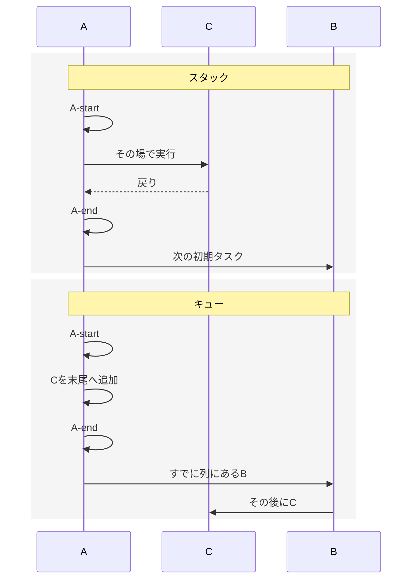
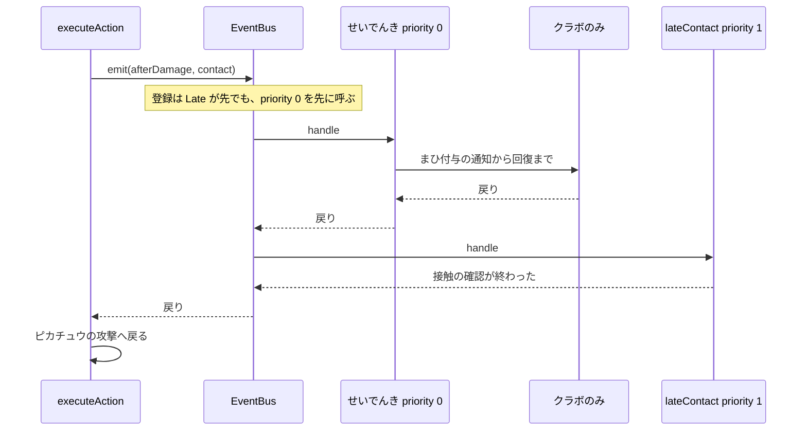

# Step 5：実行順序の管理

## 1. 目的

同じ Event に複数の EventHandler があるとき、優先度と登録順で実行順を決める。割り込みはこれまでの深さ優先（スタック）のままにする。キューは別の順序として実装し、バトルの割り込みには使わない。

Step 4 のガブリアス対カバルドン、およびせいでんき成功・クラボのみ所持のリザードン対ピカチュウは、ログも最終状態も変えない。優先度の違いは、別の学習用シナリオで検証する。

### 学習目標

- 同じ種類のハンドラが、優先度のあと登録順で並ぶことを理解する
- 割り込みが呼び出し元の続きより先に終わる、スタックの順序を理解する
- キューに積むと、すでに並んでいる処理が割り込みより先になることを理解する
- 優先度を付けても、1ターンの再発火は上限で止まることを理解する

## 2. 対象にするバトル

### 変えないもの

`runBattle()` はガブリアスとカバルドンが「じしん」を使う。ハンドラは登録しない。ログ、ターン番号、両者 HP 80 は Step 4 までと同じである。

`npm start` が呼ぶ `runStaticScenario({ staticActivates: true, attackerItem: "cheri" })` も Step 4 の成功ログのままである。せいでんきとクラボのみの `priority` は省略し、どちらも 0 として扱う。

1ターンの Section 実行 32 回、Event 発火 32 回の上限、超過時のログと例外メッセージ、実行中のハンドラ登録禁止は Step 4 のまま維持する。

### 優先度シナリオ

1対1、1ターン。ポケモン、技、ダメージ、せいでんきの成功、クラボのみの所持は Step 4 の連鎖シナリオと同じである。

追加するのは `afterDamage` のハンドラ `lateContact` だけである。接触したとき、次のログを1行追加する。HP、状態異常、持ち物は変えない。Section も呼ばない。

```text
接触の確認が終わった
```

登録順は次のとおりとする。この順のまま実行すると、確認ログがせいでんきより先になる。優先度で並べると、せいでんきの連鎖が先になる。

| 登録順 | 名前 | 種別 | priority |
| --- | --- | --- | --- |
| 1 | `lateContact` | `afterDamage` | 1 |
| 2 | `static` | `afterDamage` | 0 |
| 3 | `cheri` | `statusChanged` | 0 |

`priority` は `Number.isSafeInteger` を満たす数値で、小さいほど先に実行する。同じ値は登録順とする。省略または `undefined` は 0 とする。小数、`NaN`、正負の `Infinity`、安全な整数範囲外はエラーにする。負の整数は有効である。

`lateContact` の priority が負なら、確認ログはダメージログの直後、せいでんきの直前に出る。0 の場合も、同順位の `static` より先に登録されているので確認ログが先になる。正ならせいでんきの連鎖のあとになる。でんきショックは非接触なので、確認ログは出さない。

### 実装しないこと

- 実際の発動優先度、特性の上書き順、ゲーム内の優先度テーブル
- キューを使った攻撃の割り込み、ターン終了時の予約処理
- 実行中のハンドラ登録と解除、優先度のグループ分け
- 複数ターン、交代、ひんし、勝敗、天候、フィールド
- 上限の数値変更、非同期実行、乱数

## 3. 順序のルール

### 優先度

`register` は実行中登録の禁止を先に確認し、次に priority を検証してから登録する。不正な値なら `Error("EventHandlerのpriorityは安全な整数で指定してください: {name}")` を投げ、登録配列に追加しない。設定エラー用のバトルログは追加しない。

`emit` は、種類が一致するハンドラを登録順に集め、その時点の `priority ?? 0` を各1回読み取って検証し、ハンドラ参照と数値の組を作る。その数値の昇順で安定ソートする。バスに保存している登録配列自体は並べ替えない。比較対象は同じ発火内だけであり、異なる Event 間を優先度で横断して並べない。

並びは全対象の検証とソートを終えてから確定し、以降そのリストを順に実行する。登録したオブジェクトは参照を保持し、登録時に priority を固定しない。実行中に別ハンドラの `priority` を書き換えても、その `emit` の順番は変わらない。次に開始される `emit` は、外側がまだ実行中の入れ子も含め、その時点の値を読み直す。内側が戻っても外側は確定済みの順を続ける。

登録後に不正値へ変わる場合もあるため、発火時にも検証する。不正な対象が1件でもあれば、その発火のハンドラは1件も呼ばず、登録時と同じ例外を投げる。発火数の加算と、それ以前の状態変更は戻さない。`priority` は通常のデータプロパティとし、getter / Proxy や、登録後の `kind` / `name` / `handle` の変更は扱わない。

発火回数の加算は並べ替えより前である。33回目はハンドラを呼ばない。優先度の高いハンドラも低いハンドラも、その回は実行されない。

検証・ソート・ハンドラからの例外はいずれも呼び出し元へ伝播させる。`emitDepth` を増やした場合は必ず `finally` で戻す。発火単位の配列は局所変数に保持し、入れ子と共有しない。

### スタック

割り込みは、ハンドラが同じ Runner で `runner.run` する現行の同期呼び出しのままとする。これがスタックである。子 Section と、その中の `emit` が全部終わってから、呼び出し元ハンドラの次の行へ戻る。その後に、同じ Event の次のハンドラへ進む。

比較用に `runAsStack` を置く。`schedule` は子タスクをその場で最後まで実行してから戻る。バトルの本線はこの関数を呼ばない。順序が `runner.run` と同じであることをテストで示す。

初期列が A、B で、A が C を `schedule` してから `A-end` を記録する場合、記録は次になる。

```text
A-start → C → A-end → B
```

### キュー

`runAsQueue` は、初期列を先頭から取り出す。`schedule` は末尾へ追加するだけで、その場では実行しない。すでに列にある B が、あとから追加された C より先になる。

```text
A-start → A-end → B → C
```

比較用の両関数はバトルの Event、Section、Runner には接続せず、実行上限も持たない。有限個のタスクを同期実行する教材専用とし、無限再帰・無限追加・呼び出し終了後の `schedule` 使用・非同期タスクは対象外とする。バトルの循環対策は同じ Runner を共有する本線で検証する。



## 4. 優先度シナリオの流れ

`lateContact` の priority が 1 のとき、接触ダメージのあとで次の順になる。

```text
せいでんき → まひ付与 → きのみ消費 → まひ回復 → 接触の確認 → ピカチュウの攻撃
```



priority を `-1` にすると、Late は Static より先に呼ばれる。Late は Section を呼ばないので、せいでんきの連鎖自体の内部順は変わらない。

## 5. API

`EventHandler` に省略可能な `priority` を追加する。既存のハンドラオブジェクトは、フィールドを足さなくてよい。

```typescript
export type EventHandler = {
  name: string;
  kind: EventKind;
  priority?: number;
  handle: (event: BattleEvent, state: BattleState, runner: SectionRunner) => void;
};
```

`createEventBus` の `register` と `emit` の引数、実行中登録のエラー、`emitDepth` の戻し方は変えない。priority の検証と、`emit` 内の一致ハンドラの安定ソートを追加する。ハンドラへ渡す Event、BattleState、Runner は既存と同じ参照とし、ソート用に Event をコピーしない。`beforeDamage.damage` の変更は次のハンドラに引き継がれ、最終値をHPへ1回適用する。

スタックとキューは `src/battle/order.ts` に置く。

```typescript
export type OrderTask = {
  name: string;
  run: (schedule: (task: OrderTask) => void) => void;
};

export function runAsStack(tasks: readonly OrderTask[]): string[];
export function runAsQueue(tasks: readonly OrderTask[]): string[];
```

戻り値は、タスクを開始した順の `name` である。空配列は空配列を返す。`run` の中で外部の配列へ追記してよい。追記の位置は、スタックとキューで上の `A-start` から `C` の順になる。

初期配列は呼び出し時に浅くコピーし、入力配列を `shift` / `pop` / `push` などで変更しない。タスク本体の変更は扱わない。開始名は `run` の直前に記録し、同じタスクを2回 schedule したら2回実行する。name は識別子として重複排除しない。作業列と開始名の配列は呼び出しごとに新しく作る。

タスクが例外を投げたら同じ例外を呼び出し元へ伝播し、以降のタスクは実行しない。途中までの外部配列への追記は戻さず、戻り値の配列は返さない。スタックでは子の例外が `schedule` の呼び出し位置で伝播する。キューでは、子が実行される前に親の続きと先行タスクがすでに終わっていることがある。

A が C のあとに D も `schedule` する場合の name は次のとおりとする。

| 方式 | name の順 |
| --- | --- |
| スタック | A, C, D, B |
| キュー | A, B, C, D |

優先度シナリオの入口は `scenario.ts` に追加する。`runStaticScenario` には `lateContact` を登録しない。

```typescript
export function runPriorityScenario(options?: {
  latePriority?: number;
  trace?: string[];
}): BattleState;
```

`latePriority` の省略または `undefined` は 1。`options?.latePriority ?? 1` で既定値を決め、0 を 1 に置き換えない。有効範囲とエラーは EventHandler と共通にする。中身は Step 4 の連鎖シナリオと同じポケモンと行動選択で、EventBus へ `lateContact`、`static`、`cheri` の順に登録してから実行する。`staticActivates` は true、持ち物は `"cheri"` に固定する。

既存の `createStaticBattleSection(events, options)` と `registerStaticHandlers(events, true)` を再利用する。新しい Bus に `lateContact` を登録してから既存ハンドラを登録し、空の state と `createSectionRunner(options?.trace)` で実行する。状態生成・技選択・連鎖処理を複製しない。`lateContact` 内は `event.kind === "afterDamage"` で型を絞ってから `contact` を参照する。

## 6. ディレクトリ

```text
src/battle/
├── types.ts
├── event.ts       同じ Event を priority で安定ソート
├── order.ts       追加。スタックとキューの比較
├── section.ts
├── status.ts
├── handlers.ts    せいでんきとクラボのみ。priority は省略
├── battle.ts
├── scenario.ts    runPriorityScenario を追加
├── turn.ts
└── actions.ts
```

## 7. 実行ログ

### 優先度 1

```text
=== バトル開始 ===
リザードンが登場
ピカチュウが登場
=== ターン1 開始 ===
リザードン：ほのおのパンチ
ピカチュウ：でんきショック
行動順：
1. リザードン
2. ピカチュウ
リザードンのほのおのパンチ！
ピカチュウに20ダメージ！
ピカチュウのせいでんき！
リザードンはまひになった
リザードンはクラボのみを使った
リザードンのまひが治った
接触の確認が終わった
ピカチュウのでんきショック！
リザードンに20ダメージ！
=== ターン1 終了 ===
```

### 優先度 -1

ダメージログの直後だけが入れ替わる。

```text
リザードンのほのおのパンチ！
ピカチュウに20ダメージ！
接触の確認が終わった
ピカチュウのせいでんき！
リザードンはまひになった
リザードンはクラボのみを使った
リザードンのまひが治った
ピカチュウのでんきショック！
リザードンに20ダメージ！
```

どちらの最終状態も、リザードンとピカチュウの HP は 80、状態異常は空、リザードンの持ち物は空である。Section トレースは Step 4 の成功時と同じである。`lateContact` は Section を増やさない。

## 8. テストケース

`tests/step1.test.ts` から `tests/step4.test.ts` の検証内容は維持する。追加分は `tests/step5.test.ts` に書く。`npm test` で5ファイルを実行する。

| ID | テスト内容 | 期待結果 |
| --- | --- | --- |
| TC-01 | 既存シナリオ | `runBattle()` と、せいでんき成功の `runStaticScenario` のログ・HP・ターンが Step 4 と一致する。`npm start` の入口は変えない |
| TC-02 | 優先度 | `runPriorityScenario()` が7章の優先度1の全ログと一致する。`latePriority: -1` と `0` では確認ログだけがせいでんきより前になる。全ケースで最終HP・状態・持ち物・ターン1・Sectionトレースも一致する |
| TC-03 | 同順位 | priority 0、省略、0 の3件は、数値が同じなので登録した順に実行される |
| TC-04 | 並べ替えの確定 | A(0), B(1), C(2) を登録し、A が1回だけ C を -1 に変更して同じ種類を再発火する。外側は A, B, C、内側は C, A, B。全体は外A開始 → 内C → 内A → 内B → 外A終了 → 外B → 外C。後の独立した発火も C, A, B |
| TC-05 | スタック | 3章の A、B、C で、name は A, C, B、追記は `A-start → C → A-end → B`。C と D を順に schedule した場合の name は A, C, D, B |
| TC-06 | キュー | 同じタスクで、name は A, B, C、追記は `A-start → A-end → B → C`。C と D の name は A, B, C, D |
| TC-07 | 割り込みとの一致 | バトルのテスト用ハンドラで、子 Section の完了、呼び出し元の続き、同じ Event の次ハンドラの順が TC-05 のスタックと一致する。キューの順にはならない |
| TC-08 | 登録配列を保持 | 登録が B(1), A(0), C(0) のとき実行順は A, C, B。保持していたハンドラ参照で全 priority を0に変更して再発火すると B, A, C になる。非公開配列を公開せず外部から検証する |
| TC-09 | 入れ子の並べ替え | 外側 `afterDamage` の A(0) が内側 `statusChanged` を発火し、外側 B(1) が待つ。内側を X(100), Y(50) の順に登録すると A開始 → Y → X → A終了 → B。内側の数値が外側 B より大きくても先に完了する |
| TC-10 | 循環と優先度 | 直前の `beforeDamage` を含む Event 総数33回目で Step 4 と同じ上限エラーになる。再発火する priority 0 は31回、priority 1 は0回実行され、後続の行動と TurnEnd も実行されない |
| TC-11 | priority の検証 | 省略・0・負数・安全な整数の両端を受理する。小数・NaN・正負Infinity・範囲外は登録前に拒否する。登録後の不正値も発火時に拒否し、その発火は先頭ハンドラから一切実行しない。例外後に修正・再発火でき、発火深度が残らない |
| TC-12 | ダメージ補正の順序 | `beforeDamage` に加算10(priority 1)を先に、倍化(priority 0)を後に登録する。基礎20は倍化→加算で50となり、同じ Event を共有してHP100から50へ1回減少する。逆順の60にならない |
| TC-13 | 比較関数の再利用 | 両関数で入力配列が変化せず、同じ入力を再実行しても結果を共有しない。同じタスクを2回 schedule すると名前も実行も2回になる |
| TC-14 | 比較関数の多段と例外 | A が C を、C が D を schedule する場合、開始名はスタック A,C,D,B、キュー A,B,C,D。C が例外を投げる場合は本文の停止位置と既存の副作用を確認する |
| TC-15 | シナリオの分離 | 優先度シナリオを2回実行して状態を共有しない。その後の `runStaticScenario` と `runBattle()` に確認ログや優先度変更が漏れない |

TC-10 は新しい Bus に `afterDamage` の再発火ハンドラ(priority 0)と記録用ハンドラ(priority 1)だけを登録する。せいでんき・クラボのみは登録しない。テスト側で state と trace を保持し、`createStaticBattleSection` を同じ Runner で実行する。最初の `beforeDamage` が1回目、最初の `afterDamage` が2回目であり、総数32回目までに再発火ハンドラは31回呼ばれる。そのハンドラ内から試みる次の `afterDamage` が33回目として拒否される。再発火時にカウンタをリセットしたり、新しい Runner を作ったりしない。

TC-10 のエラーメッセージと末尾の原因ログは、次の文字列と一致させる。原因ログは1回だけ残す。HPはリザードン100・ピカチュウ80のままで、最初のダメージは巻き戻さない。後続ハンドラ、ピカチュウの行動、`TurnEnd` が実行されていないことも確認する。

```text
1ターンのEvent発火数が上限32を超えました: afterDamage
```

空の `runAsStack([])` と `runAsQueue([])` は空配列を返す。この確認は TC-05 と TC-06 に含めてよい。

TC-14 の例外ケースは A が `A-start` を記録し、C を schedule したあとに `A-end` を記録する構成とする。C は `C` を記録してから共通の Error オブジェクトを投げる。スタックの外部記録は `A-start, C`、キューは `A-start, A-end, B, C` で止まり、同じ Error が呼び出し元へ届く。失敗後の新しい呼び出しへ作業列を持ち越さない。

## 9. 完了条件

- [ ] 同じ Event のハンドラが、小さい priority から実行され、同じ値は登録順になる
- [ ] 不正な priority を登録時・発火時に拒否し、入れ子でも各発火の確定済み順序を維持する
- [ ] 登録順が遅くても priority 0 のせいでんきが、priority 1 の確認より先に完了する
- [ ] `runAsStack` が深さ優先、`runAsQueue` が先に並んでいたタスク優先になる
- [ ] 比較関数が入力配列を変更せず、例外を伝播し、呼び出し間で作業列を共有しない
- [ ] バトルの割り込みはスタックの順のままで、キューでは実行しない
- [ ] 再発火が上限を超えると、後順位のハンドラと後続の行動へ進まない
- [ ] `runBattle()` と `runStaticScenario` の成功結果が Step 4 から変わらない
- [ ] `npm test` と `npm run typecheck` が PASS する

## 10. Step 6への引き継ぎ

実行順は、同じ Event 内の優先度と、割り込みのスタックで決まる。キューは比較用に残し、ターン終了の予約や天候にはまだ使わない。

Step 6 では、複数ターン、交代、ひんしのあとで行動を止める条件を先に定義する。
